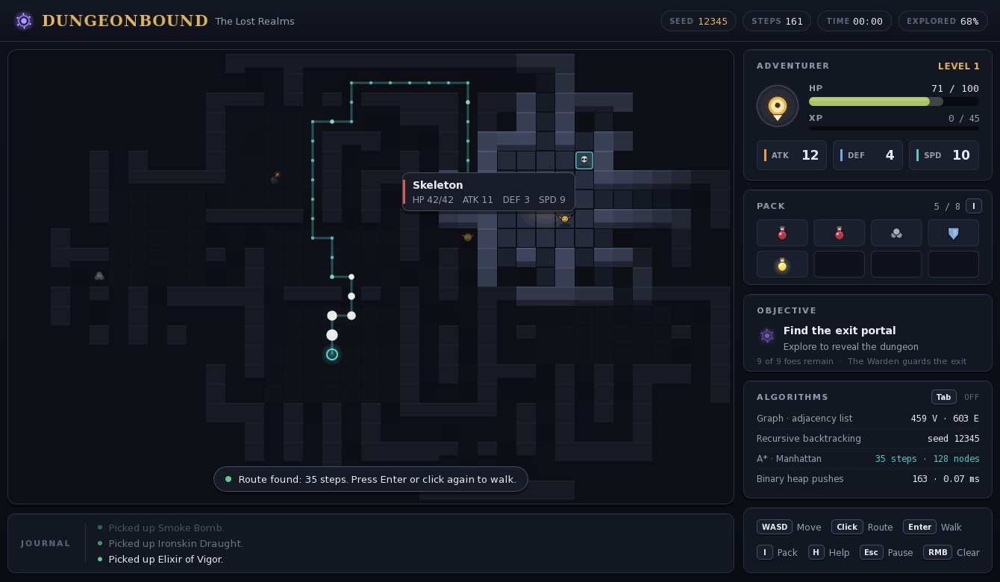

# Dungeonbound: The Lost Realms

A 2D dungeon exploration, inventory and turn-based battle game written in C++17 with SFML 3. It is also a showcase of hand-built data structures and algorithms. Every core system runs on a structure the team wrote, and no STL container stands in for one.

DSA Lab project · BCS-3F · FAST-NUCES Karachi
Isbah Rafay (25K-0664) · Maheen Kamran (25K-0598) · Instructor: Miss Fatima Gado



---

## 1. Gameplay

You start in a procedurally generated dungeon that is different on every run. Explore it, pick up potions and relics, and fight enemies in turn-based combat. To win, reach the **exit portal**, which the **Warden** (a boss) guards. If your health reaches 0, you lose and can retry the same dungeon or start a new one.

- **Fog of war.** You only see tiles in your line of sight (radius 6). Explored tiles stay on the map.
- **Enemies** (Slime, Goblin, Skeleton, Orc, Warden) stand still. Walking into one starts a battle. Deeper enemies are tougher.
- **Items:** Health Potion, Elixir of Vigor, Fire Bomb, Strength Tonic, Ironskin Draught, Smoke Bomb. The pack holds 8.
- **Levelling.** Each win gives XP. Levelling up raises max HP, ATK and DEF.
- **Seeds.** Every dungeon has a seed, shown in the top bar. Use *Play a Seed* on the title screen to replay that exact layout.

## 2. Controls

| Input | Action |
| --- | --- |
| `W A S D` / arrow keys | Move (hold to keep walking) |
| Left click on a tile | Plot an A\* route to it |
| Click the same tile again / `Enter` | Walk the plotted route (press `Enter` again to stop) |
| `Space` | Take one step along the route |
| `P` | Plot a route to the exit portal (once you have discovered it) |
| Right click | Clear the route |
| `I` (or `B`) | Open or close the inventory |
| `Tab` | Cycle the debug overlays: A\* search → dungeon graph → off |
| `F2` | Reveal the whole map (demo / grading aid) |
| `H` / `F1` | How-to-play screen |
| `Esc` | Back, close a panel, or pause |

**Inventory:** `W`/`S` or `1`–`8` select an item. `U`/`Enter` uses it. `X` discards it (press twice to confirm). Mouse clicks work on every slot and button.

**Battle:** `1` Attack · `2` Defend · `3` Use item · `4` Escape. You can also highlight an action with `WASD` / arrow keys and press `Enter`, or click it. `I` opens the item picker directly. **Menus:** `W`/`S` + `Enter`, or the mouse.

## 3. Building and running

### Requirements

| Tool | Version used | Notes |
| --- | --- | --- |
| C++ compiler | GCC 16.2 (MSYS2 UCRT64) | Any C++17 compiler should work; MSVC is supported by the CMake file |
| CMake | 3.21 or newer (4.4 used) | |
| Ninja | any | Or another generator CMake supports |
| SFML | **3.0.x** (3.0.2 used) | Graphics, Window, System. SFML 2.x will **not** work. |

### Windows (MSYS2, the setup used for development)

1. Install [MSYS2](https://www.msys2.org/). In the **MSYS2 UCRT64** shell, run:
   ```sh
   pacman -S --needed mingw-w64-ucrt-x86_64-gcc mingw-w64-ucrt-x86_64-cmake \
                      mingw-w64-ucrt-x86_64-ninja mingw-w64-ucrt-x86_64-sfml
   ```
2. Add `C:\msys64\ucrt64\bin` to your `PATH`, or keep working in the UCRT64 shell.
3. From the project folder, run:
   ```sh
   cmake -S . -B build -G Ninja -DCMAKE_BUILD_TYPE=Release
   cmake --build build
   ```
4. Run the tests and then the game:
   ```sh
   ./build/dungeon_tests.exe
   ./build/dungeonbound.exe
   ```

The build copies the fonts to `build/assets/`, so the game runs from the `build` folder.

**Portable folder (optional).** Run `cmake --install build --prefix dist`. This creates `dist/` with the executable, its assets and every DLL it needs, so it runs on a PC without MSYS2.

### Linux / macOS

Install SFML 3 from your package manager (or build it from source), then use the same `cmake` commands.

### Tests only (no SFML needed)

The game logic and the tests do not depend on SFML:

```sh
cmake -S . -B build-tests -DDUNGEONBOUND_BUILD_GAME=OFF
cmake --build build-tests
ctest --test-dir build-tests --output-on-failure
```

### Screenshots

`dungeonbound --shots <folder>` renders every screen to PNG files without opening a window. The images in `x/` were made this way.

## 4. Project structure

All of the code, including the tests, is in one file, `src/main.cpp`, split into numbered sections. Each section only uses the ones above it. Part A (the data structures and game rules) has no SFML code. The same file builds two programs:

- `dungeonbound.exe` (the game): Part A + Part B, built with no flags.
- `dungeon_tests.exe`: Part A + Part C. It is built with `DUNGEONBOUND_NO_GAME`, which leaves out the SFML code, and `DUNGEONBOUND_TESTS`, which adds the tests. So the tests build without SFML (PRD §8), and none of the test code ends up in the game.

```
src/main.cpp
  Part A — game logic, no SFML
     1. DynamicArray       growable array (rule of five), replaces std::vector
     2. BinaryHeap         array-backed binary heap with a pluggable comparator
     3. Graph              undirected weighted graph, adjacency lists of linked edge nodes
     4. Rng                seeded random source (reproducible layouts)
     5. Items and entities player, enemies, item definitions
     6. Inventory          capacity-limited pack and item effects
     7. Dungeon            tile grid + its graph (every walkable tile is a vertex)
     8. DungeonGenerator   recursive-backtracking maze, rooms, loops, validation, placement
     9. Pathfinder         A* search (Manhattan heuristic, binary-heap open set)
    10. BattleSystem       turn-based combat; heap-driven turn queue
    11. GameSession        one run: movement, fog of war, pickups, battles, win/lose
  Part B — SFML game
    12. Theme              palette and layout sizes
    13. Fonts              font loading
    14. Drawing helpers    shapes, text, bars, buttons, icons
    15. Input              key → command mapping
    16. Map renderer       dungeon, fog, entities, route and DSA overlays
    17. HUD                top bar, sidebar status cards, journal
    18. Inventory panel    inventory screen / in-battle item picker
    19. Battle screen      battle interface with a live turn-order strip
    20. Menus              title, pause, help, victory / defeat screens
    21. Game               window, main loop, screen state machine
    22. main()
  Part C — tests (only in dungeon_tests.exe)
    23. Test framework     TEST / CHECK macros and the test runner
    24. Tests              35 tests (see §6)
    25. Test main()
assets/fonts/              DejaVu fonts (free licence, see assets/fonts/LICENSE)
x/                         screenshots
```

**Screen state machine:** Title → Exploring ⇄ Inventory / Paused / Help; Exploring → Battle ⇄ Battle item picker; Battle → Exploring (won / escaped) or Defeat; Exploring → Victory.

## 5. Implemented data structures and algorithms

| Game feature | Structure / algorithm | Where |
| --- | --- | --- |
| Dungeon layout | Recursion + backtracking | `DungeonGenerator::carveMaze` |
| Rooms and connections | Graph (adjacency list) | `Graph` (section 3), built by `Dungeon::buildGraph` |
| Click-to-move, route to exit | A\* with Manhattan heuristic | `Pathfinder` (section 9) |
| A\* open set | Binary min-heap on *f = g + h* | `Pathfinder::search` |
| Battle turn order | Binary min-heap on next-action time | `BattleSystem` (section 10) |
| Connectivity validation | Breadth-first search | `Graph::bfsDistances` |
| All "lists of things" | Dynamic array | `DynamicArray` (section 1) |

### Graph (adjacency list)
Each tile `(x, y)` is vertex `y * width + x`. Each pair of walkable, orthogonally adjacent tiles is joined by an undirected edge of weight 1. Every vertex owns a hand-written singly linked list of `GraphEdge` nodes. The graph supports adding vertices and edges (rejecting duplicates, self loops and invalid ids), removing edges, `hasEdge`, `neighbors`, `degree`, BFS distances, `isConnected` and `reachableCount`. It follows the rule of five: deep copy, move, and a destructor that frees every node. Press **Tab twice** in-game to see the graph drawn over the map.

### Procedural generation (recursion + backtracking)
1. `carveMaze` starts at a random odd cell and marks it visited. It shuffles the four directions and recurses into each unvisited cell two tiles away, opening the wall between them. When a cell has no unvisited neighbours, the call returns. That return is the backtrack step. The result is a perfect maze.
2. Up to 7 rooms are carved on top of the maze. Rooms must stay inside the solid border and keep at least one tile away from each other.
3. A few walls are knocked out to create loops, and short dead ends are pruned. Removing a degree-1 tile can never disconnect the map.
4. The graph is built. A BFS from the start proves that every walkable tile is reachable, and the exit goes on the farthest tile. If validation fails, the generator rerolls the layout (up to 16 attempts).
5. Enemies and items go on distinct, reachable floor tiles. The Warden stands next to the exit.

The same seed always produces the same dungeon (`std::mt19937` is fully specified by the C++ standard, and the range mapping is our own).

### A\* pathfinding
`Pathfinder::findPath` searches the dungeon graph using edge costs and a Manhattan-distance heuristic. The heuristic is admissible for 4-way movement, so routes are optimal. The open set is the custom `BinaryHeap`, ordered by lowest *f*. Ties go to the smaller *h*, then the smaller id, which keeps results deterministic. Stale heap entries are skipped (lazy deletion). An optional mask restricts the search: in game, it may only use explored tiles and steers around visible enemies. If the open set empties, the result is a clear **no path**, and the game shows a message instead of moving. The route is drawn on the map. You can walk it automatically or one step at a time. Press **Tab** to see every node the last search expanded. The sidebar shows path cost, nodes expanded, heap pushes and search time.

### Binary heap
`BinaryHeap<T, Compare>` is an array-backed heap stored in a `DynamicArray`. It provides `push` / `pop` in O(log n), `top` in O(1), a non-throwing `tryPop`, and an `isValid()` check used by the tests. A min-heap or max-heap is chosen by the comparator.

### Turn-based combat (heap-driven)
Each combatant has HP, ATK, DEF and **SPD** (initiative). Acting costs `100 / SPD` time units. The turn queue is a min-heap keyed on each combatant's *next action time*, so a fighter twice as fast acts twice as often. Ties go to whoever was scheduled first. The battle screen's top strip is a live preview of the queue. It is computed on a *copy* of the heap.

- **Attack:** damage = ATK ± variance − DEF (minimum 1), with a chance to crit.
- **Defend:** halves incoming damage until your next turn.
- **Use item:** heal, buff, Fire Bomb (30 damage) or Smoke Bomb (guaranteed escape).
- **Escape:** chance based on relative speed. The Warden cannot be escaped.

Invalid actions do **not** consume the turn. This covers an empty pack, a bad slot, a potion at full HP, or trying to flee the boss. The game explains why instead (FR-B5). Battles end in a win, a loss or an escape. A loss leads to the Defeat screen, where you can restart.

## 6. Tests

`dungeon_tests` holds 35 tests with 478 checks. They cover every area in the PRD's test plan (§10.1):

| Area | What is tested |
| --- | --- |
| DynamicArray | push/insert/remove, deep copy, move, self-aliasing push, bounds errors |
| Graph | add vertices/edges, neighbours, degree, removal, connectivity, BFS, copy/assign, duplicate / self-loop / invalid edges |
| Generation | 500 seeds pass full validation (connected, start/exit reachable, solid border, rooms in bounds and non-overlapping, entities on distinct walkable tiles); same seed ⇒ same map; different seed ⇒ different map |
| A\* | optimal path on a known grid, no path, start = goal, wall / invalid goal, passable mask, A\* cost equals BFS distance on 50 generated dungeons |
| Binary heap | ordered extraction, max-heap, ties, empty extract, 20,000 random values, turn-event tie-break |
| Inventory | collect, use, discard, capacity limit, invalid index, empty pack, every item effect |
| Combat | initiative turn order, damage and enemy death, defend halves damage, invalid actions keep the turn, escape rules (boss / Smoke Bomb), player death, healing at 1 HP, minimum damage, XP and enemy removal after a win |
| Movement | wall collision, map boundary, item pickup, enemy contact starts a battle, reaching the exit wins |

Run the suite with `./build/dungeon_tests.exe` or `ctest --test-dir build`. It exits non-zero if any check fails.

## 7. PRD compliance checklist

| Requirement | Status |
| --- | --- |
| FR-G1 – G3 graph | Done: `Graph` (section 3) |
| FR-P1 – P5 generation | Done: recursive backtracker, validation + reroll, seeded |
| FR-M1 – M4 movement | Done: keyboard movement, pickup, battle on contact, exit wins, click-to-route |
| FR-A1 – A4 A\* | Done: Manhattan heuristic, heap open set, no-path feedback, drawn and walkable route |
| FR-B1 – B6 combat | Done: heap turn queue, 4 actions, invalid actions rejected, defeat → restart |
| FR-I1 – I3 inventory | Done: collect / view / inspect / use / discard, capacity 8, edge cases |
| FR-U1 – U3, U5 UI | Done: dungeon view, HUD, inventory panel, battle screen, keyboard control, vector placeholder art |
| FR-U4 mouse (P1) | Done: buttons, inventory slots, path destination |
| FR-I4 – I6 hash table / BST / undo (P1) | Not implemented (optional extensions) |
| No `std::list/map/stack/queue/priority_queue` | Confirmed: core structures are all team-written |
| README + tests | This file; 35 passing tests |

## 8. Credits

- Fonts: DejaVu (Bitstream Vera licence), in `assets/fonts/`.
- Graphics: SFML 3, https://www.sfml-dev.org/
- All game art is drawn in code with SFML shapes. No external images are used.
